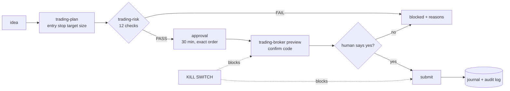

<div align="center">

# trading-skills

**Trading skills for AI agents. Any market. Any broker. Zero API keys to start.**

Turn Claude, Codex, Cursor or Gemini CLI into a disciplined trading co-pilot for any market - US, India
(NSE/BSE), UK, Europe, Asia, crypto, forex: scan for setups, read the news and results, track insider and
Congress trades, time the entry bar by bar, plan exact stops and sizes, enforce your risk rules, check the
odds, set alerts, journal everything and route orders - paper by default, live only with your confirmation.

[](LICENSE)


[](https://agentskills.io)

</div>

## Get started

You need two things: **Python** (free, from [python.org](https://www.python.org/downloads/), version 3.9 or newer) and an
AI assistant that can run tools, such as Claude, Codex, Cursor or Gemini CLI. Nothing else is installed or paid for.

### 1. Install: pick the easiest option for you

**Option A - let your AI do it (easiest, no typing commands).** Open your AI assistant and paste this:

```text
Install the trading skills from https://github.com/reddygopalkrishna/trading-skills into my assistant,
then set them up with a 50,000 USD practice (paper) account, benchmark SPY and 1% risk per trade.
Do not place any real orders.
```

**Option B - Claude Code (one line each):**

```bash
/plugin marketplace add reddygopalkrishna/trading-skills
/plugin install trading-skills@trading-skills
```

**Option C - any AI tool, via skills.sh:**

```bash
npx skills add reddygopalkrishna/trading-skills
```

**Option D - claude.ai or the Claude desktop app:** download the `.skill` files from the
[latest release](https://github.com/reddygopalkrishna/trading-skills/releases) and upload them under
*Customize -> Skills* (code execution must be enabled).

**Option E - manual copy (for developers):**

```bash
git clone https://github.com/reddygopalkrishna/trading-skills
cp -r trading-skills/skills/* ~/.claude/skills/     # or ~/.codex/skills, ~/.cursor/skills, ~/.gemini/skills
```

### 2. Configure: tell it about your money

Configuration is a short set of answers saved on your own computer, in a file called `config.json` inside
`~/.trading-skills/`. Nothing is sent anywhere. You can set it by asking your AI in plain words, or run it yourself:

```bash
cd skills/trading-setup
python3 scripts/setup.py doctor                                             # checks that everything works
python3 scripts/setup.py init --equity 50000 --currency USD --benchmark SPY  # your account and market
```

What the answers mean:

| setting | plain meaning | examples |
|---|---|---|
| `--equity` | how much money the account has, used only for sizing | `50000` |
| `--currency` | the money you use | `USD`, `INR`, `GBP` |
| `--benchmark` | the market index you compare with | `SPY` (US), `^NSEI` (India Nifty 50), `^FTSE` (UK) |
| `--risk-pct` | the most you are willing to lose on one trade, as a percentage of the account | `1` (1%) |
| broker | `paper` (default) means practice money. A live broker is off until you switch it on yourself | `paper` |

**Practice first.** Everything starts on paper trading: fake money, real prices. Real orders need a separate,
deliberate switch and your confirmation on every order.

Then ask your agent things like:

```text
"Set up trading-skills: 50,000 USD account, benchmark SPY, risk 1% per trade."
"How's the market?"                          "Analyze AAPL - daily and weekly."
"Any news on RELIANCE.NS today?"             "How were TCS's last results?"
"Watch INFY for an opening-range breakout."  "Plan a long in MSFT with a 2 ATR stop."
"Backtest buying RSI(2) < 10 above the 200-day on these 20 stocks since 2012, out-of-sample from 2021."
"What are the odds my 2R target hits before the stop?"
"Paper-buy it."                               "Review my trades this month."
```

Or run any skill yourself from a terminal:

```bash
cd skills/trading-chart && python3 scripts/analyze.py AAPL
cd skills/trading-backtest && python3 scripts/backtest.py --spec assets/strategies/donchian-breakout.json \
    --universe SPY,QQQ,GLD,TLT --start 2008-01-01 --oos-start 2018-01-01 --report donchian.html
```

For the full walkthrough (first paper trade, symbols for every market, every skill's commands, live trading
setup, scheduling, troubleshooting), read the [usage guide](docs/USAGE.md).

## The 21 skills

| stage | skill | what it does |
|---|---|---|
| start | 🧭 [trading-start](skills/trading-start) | Start here. Routes any goal to the right skill; daily brief (regime, risk, positions vs stops, scans, patterns) for scheduled runs |
| | ⚙️ [trading-setup](skills/trading-setup) | Account, currency, benchmark, risk limits, data provider, broker login, live switch |
| | 📈 [trading-data](skills/trading-data) | OHLCV bars and quotes for any symbol, daily to 1-minute, CSV export, caching |
| find | 🌊 [trading-market](skills/trading-market) | Risk-on / choppy / correction / risk-off from trend, volatility, drawdown and breadth -> suggested exposure |
| | 🔎 [trading-scanner](skills/trading-scanner) | Plain-English ideas -> safe rule language; 14 presets (trend template, momentum, squeeze, golden cross...) |
| | 🧩 [trading-patterns](skills/trading-patterns) | VCP, breakout on volume, bull flag, cup & handle, double bottom, inside bar, NR7, pocket pivot - with pivot and stop |
| research | 🔬 [trading-chart](skills/trading-chart) | Trend stage, MAs, RSI, MACD, ADX, ATR, squeeze, Supertrend, OBV, S/R levels, daily vs weekly, explained bias score |
| | 📰 [trading-news](skills/trading-news) | Only what is new since your last check, tagged and timed: Google News (every market), Yahoo, SEC 8-Ks; MOVING flags |
| | 💰 [trading-earnings](skills/trading-earnings) | Quarterly revenue, margins, EPS vs a year ago, TTM, one-off flags - any market (Yahoo) and SEC filings for US |
| | 🕵️ [trading-insiders](skills/trading-insiders) | US Congress trades (Pelosi tracker, read from the PDFs), SEC Form 4, India NSE bulk/block deals and SEBI insider trades |
| time | ⏱️ [trading-entry](skills/trading-entry) | Bar-by-bar entry timer: opening-range or level breaks, long or short, volume check, any exchange's session, replays |
| plan | 🗺️ [trading-plan](skills/trading-plan) | Entry, stop options, targets, R:R, invalidation and size; futures multipliers, fractional crypto, regime scaling |
| | 🧮 [trading-fno](skills/trading-fno) | F&O analysis: option Greeks, implied volatility, multi-leg payoff (spreads, straddles, iron condor), chain OI / PCR / max pain. US live (Cboe, delayed); India from the NSE chain CSV you download or Kite. Analysis only |
| | 🎲 [trading-odds](skills/trading-odds) | Odds a setup hits target before stop; drawdown and ruin ranges from your trade history |
| | ⚖️ [trading-size](skills/trading-size) | Fixed-fractional, lots and margin, size tables, Kelly, volatility targeting, risk of ruin |
| protect | 🛡️ [trading-risk](skills/trading-risk) | 12 hard checks against your limits; issues the approval the broker step requires; live risk dashboard |
| execute | 🚦 [trading-broker](skills/trading-broker) | Paper (default) or live orders with preview + confirm code, OCO stop/target, GTT stops, kill switch, audit log |
| | 🔔 [trading-alerts](skills/trading-alerts) | Price, stop/target, % move, opening bell and before-the-close alerts on each exchange's own clock |
| learn | 📓 [trading-journal](skills/trading-journal) | SQLite journal: plans, fills, R-multiples, grades, notes; CSV import/export |
| | 📊 [trading-review](skills/trading-review) | Stats by setup/side/month, coaching on leaks (cutting winners, holding losers, ignored stops), HTML report |
| | 🧪 [trading-backtest](skills/trading-backtest) | Portfolio backtests with no look-ahead, costs, stops/targets/trails, ranking, out-of-sample split, HTML report |

## What you can trade

Anything with price bars works, on most exchanges in the world (Yahoo format):

| asset | examples |
|---|---|
| Stocks and ETFs | `AAPL`, `SPY`, `RELIANCE.NS`, `HSBA.L`, `SAP.DE`, `7203.T`, `0700.HK`, `BHP.AX` |
| Indices | `^GSPC`, `^NDX`, `^NSEI`, `^FTSE`, `^N225` |
| Crypto | `BTC-USD`, `ETH-USD`, `SOL-USD` |
| Forex | `EURUSD=X`, `USDJPY=X`, `USDINR=X` |
| Futures (continuous) | `ES=F`, `NQ=F`, `GC=F`, `CL=F` |

Position sizing handles shares, futures lots and multipliers, and fractional crypto. Bring your own CSVs for
anything else. India: NSE (`.NS`) and BSE (`.BO`) work in every skill; the entry timer and alerts follow NSE's
09:15-15:30 session.

**Brokers.** Analysis works with any broker. Paper trading is built in. Live order adapters exist for Zerodha
Kite (tested in use), and for Fyers, Upstox, Dhan and Groww (beta: written against each broker's official API,
tested offline, not yet run against live accounts). Angel One is not supported yet. Symbol formats and
per-broker login steps are in the [usage guide, section 7](docs/USAGE.md#7-live-trading-through-a-broker).

## What it costs

| piece | cost |
|---|---|
| All 21 skills | **free** (MIT) |
| Market data (Yahoo Finance, default) | **free**, no key - unofficial endpoint, may be delayed or rate-limited |
| Your own CSV data | free |
| Paper trading | **free** - built-in simulated broker |
| Live orders through your broker | depends on your broker's API plan (see the usage guide) |

You can analyse, screen, backtest, simulate, journal and paper-trade without spending anything or creating a
single account.

## Safety model



- **Paper by default.** Live orders need `live on --i-understand-the-risks` *and* a live broker.
- **No approval, no order.** The router refuses opening orders without a fresh gate PASS for that exact symbol/side/qty/stop.
- **Human in the loop.** Every submission needs a single-use confirm code shown in a preview.
- **Kill switch** halts all submissions; `--flatten` closes paper positions and cancels live orders.
- **Audit log** of every preview, submit, cancel and gate decision in `~/.trading-skills/audit.log`.
- **Your limits, enforced:** risk per trade, position size, portfolio heat, max positions, daily loss, losing streak, drawdown, minimum R:R.

Automation-friendly by design: schedule the brief, scans, paper fill processing and weekly reviews.
Live order submission deliberately keeps a human confirmation step. See
[workflows](skills/trading-start/references/workflows.md).

## Contributing

PRs welcome - new broker adapters, indicators, patterns and presets especially. Read [CONTRIBUTING.md](CONTRIBUTING.md).
Edit `core/tradekit/`, run `python3 tools/sync_core.py`, then `python3 tools/validate_skills.py` and
`python3 -m unittest discover -s tests`. Everything runs offline.

If this saves you time, **star the repo** - it helps other traders find it.

## Disclaimer

Educational and research software. **Not financial advice.** Trading involves substantial risk of loss,
including loss of more than your initial investment with leveraged products. Backtests and simulations describe
the past and are not predictions. Free market data can be delayed or wrong. You are solely responsible for
every decision, order and outcome, and for complying with your broker's and regulator's rules (for example,
requirements for API trading such as registered IPs or algorithm identifiers). Provided "as is" under the MIT
license, without warranty.
